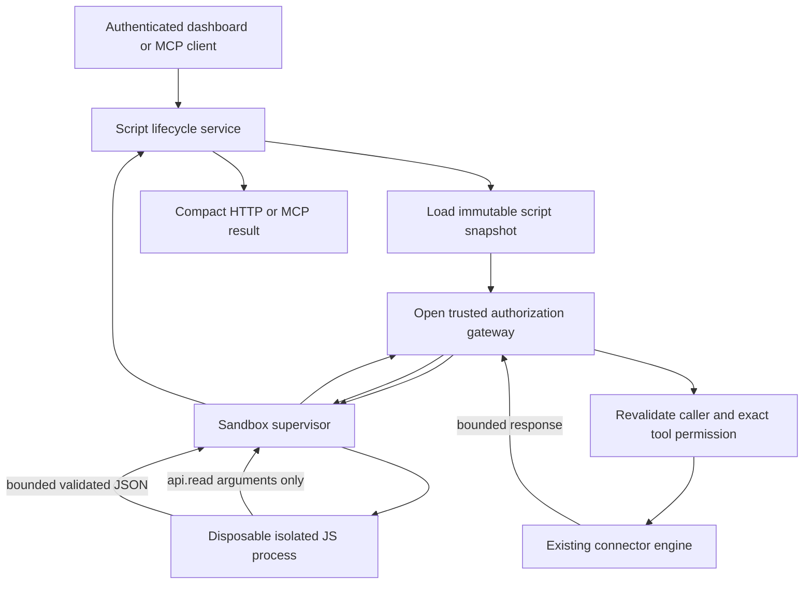

# CODEBOUND — AnythingMCP codebase and architecture guide

> **Status (2026-10-17):** Contracts, isolated sandbox, gateway and [Phase A persistence](PERSISTENCE.md) are present on `feat/codebound-lifecycle`. HTTP/MCP lifecycle wiring and end-to-end execution remain pending. Paths are repository-relative.

## 1. What we're building

**AnythingMCP** already connects MCP clients/AI assistants with external systems through managed connectors and tools. **CODEBOUND** adds a controlled way to create, save, edit, delete, and execute reusable scripts that work with those existing tools, reduce returned data, and can themselves be exposed as MCP tools.

Core challenge outcomes:
1. Manage the script lifecycle and expose saved scripts as callable MCP tools.
2. Allow authorized connector operations without revealing credentials or pushing intermediate datasets through the LLM context.
3. Install connector-associated scripts from the existing marketplace.
4. Execute untrusted scripts in a confined environment with tenant isolation, network/host restrictions, and resource limits.

Keep existing AnythingMCP infrastructure. Do **not** implement a new integration platform or introduce an LLM into deterministic script execution.

### MVP agreement

- One saved JavaScript `async function main(input, api)`.
- One explicitly bound connector and backend-approved **REST GET** tool; at most **one** connector call per run.
- Authenticated, owner-only initial workflow; 16 KiB maximum output JSON.
- Direct per-server MCP integration first; shared/global MCP exposure later.
- One real working connector and a measurable compact result.
- Marketplace-associated script installation remains an official requirement, even if sequenced after end-to-end execution.
- A single call does **not** establish pagination, streaming, or complete coverage of large datasets.

## 2. Repository map

| Location | Responsibility | CODEBOUND impact |
| --- | --- | --- |
| `packages/frontend/src/app/` | Next.js App Router screens | Add script management screen |
| `packages/frontend/src/lib/api.ts` | Typed frontend HTTP request helpers | Add script CRUD/run client methods |
| `packages/frontend/src/components/app-sidebar.tsx` | Dashboard navigation | Link Scripts page |
| `packages/backend/src/app.module.ts` | NestJS application module composition | Register future CODEBOUND module |
| `packages/backend/src/auth/` | JWT/MCP authentication and user identity | Construct trusted execution principal |
| `packages/backend/src/roles/roles.service.ts` | Role-to-tool permission checks | Recheck each script-initiated tool operation |
| `packages/backend/src/mcp-servers/` | MCP server configurations, sessions and connection grants | Enforce server scope and client grants |
| `packages/backend/src/mcp-server/` | Dynamic tool registry, MCP endpoint exposure and invocation | Register and invoke saved scripts |
| `packages/backend/src/connectors/` | Connector CRUD, credentials, execution engines, response shaping | Reuse via trusted connector gateway |
| `packages/backend/src/adapters/` | Built-in connector catalog and installation | Extend installations with script templates |
| `packages/backend/prisma/schema.prisma` | PostgreSQL models managed by Prisma | CodeboundScript/CodeboundScriptRun, authorized by issue #1 |
| `packages/backend/src/common/` | Prisma/Redis/deployment/HTTP safeguards | Reuse relevant services |
| `packages/backend/src/codebound/` | New project-owned CODEBOUND module area | Contracts, isolated runner, authorized gateway and Phase A persistence |
| `deploy/codebound/` | Proposed runner infrastructure | **Does not yet exist** |

### Technologies already in use

- Backend: **NestJS + TypeScript**.
- Frontend: **Next.js + React + TypeScript**.
- Persistence: **PostgreSQL + Prisma**.
- Optional infrastructure: **Redis** (caching/counters; not proof of an existing durable job queue).
- Connector engines: **REST, GraphQL, SOAP, database, upstream MCP, OData**.
- Validation/testing: **Zod**, **class-validator**, **Jest**; frontend has ESLint, TypeScript and Playwright.
- Docker Compose is used for app/database development and deployment. It is **not itself a secure untrusted-code sandbox**.

## 3. Understand three different objects

- **Connector:** one configured integration (for example, a Todoist connection), including trusted service configuration and credentials. It belongs to an organization.
- **Tool:** one operation on a connector (for example, fetch active tasks). The tool has a name, parameter schema, connector ID, mapping and permissions.
- **CODEBOUND script (planned):** saved source plus input/output schemas and an **exact permitted tool binding**. It may invoke only that approved tool through a gateway. It must not receive the connector's decrypted configuration.

**Do not confuse a saved script with an existing connector tool**. Saved-script discovery, invocation, refresh and persistence must be added explicitly.

## 4. Existing connector tool flow — source-verified entry points

### 4.1 Tool registration

1. `packages/backend/src/mcp-server/mcp-server.service.ts`: `McpServerService.loadAllTools()`, `registerConnectorTools()` and `reloadConnectorTools()` load/reload configured tools.
2. `packages/backend/src/mcp-server/tool-registry.ts`: `ToolRegistry.registerTool()`, `getTool()`, `getToolForOrg()` and `getListableTools()` hold registered metadata, organization and connector mappings.
3. `McpServerService.registerMcpTool()` attaches tool handlers to MCP infrastructure. The registry includes decrypted connector configuration in **trusted backend memory**; never forward it into untrusted script execution.

### 4.2 MCP entry points

- `packages/backend/src/mcp-server/mcp-endpoint.controller.ts`, `handleGlobalPost()`: shared `/mcp`; tool visibility is scoped for the invoking caller.
- `packages/backend/src/mcp-server/shared-toolset.ts`, `registerSharedToolset()`: fixed shared tools such as `anythingmcp_search_tools`, `anythingmcp_describe_tool`, `anythingmcp_run_read_tool` and `anythingmcp_run_write_tool`. The shared list is not the same as all workspace connector tools.
- `McpEndpointController.handleMcpRequest()`: `/mcp/:serverId` per-server MCP endpoint, using server-scoped tool planning, including `planToolSet()`.
- `packages/backend/src/mcp-server/dynamic-mcp-tools.ts`, `DynamicMcpTools.executeTool()`: resolves a registered tool, handles configuration, cache/audit/engine dispatch and output rendering; `executeWithEngine()` chooses the engine, `renderResult()` prepares MCP content.

### 4.3 Connector execution

- `packages/backend/src/connectors/connectors.service.ts`, `executeConnectorCall()`: a **second** execution path used for connector testing/installation probes; do **not** assume it independently implements all per-user MCP authorization.
- `packages/backend/src/connectors/engines/rest.engine.ts` dispatches REST requests and injects configured auth; `mcp-client.engine.ts` calls upstream MCP; there are additional GraphQL/SOAP/database/OData engines.
- `packages/backend/src/connectors/response-transform.util.ts` supports existing response transformations/JMESPath and optional output-byte limits. It transforms data **after retrieval**; it is not a generic streaming or multi-page engine.

**Important:** Authentication, authorization, registration, connector execution and response shaping are separate concerns. Calling an engine directly from sandbox code would bypass the required checks.

## 5. Existing authorization and security model

- `auth/jwt.strategy.ts`: validates JWTs and derives authenticated dashboard user/organization context.
- `auth/mcp-combined-auth.guard.ts`: supports multiple MCP auth modes, including user keys, JWT and configured instance/static modes. **The initial CODEBOUND slice supports only authenticated user JWT flows**; reject unsupported identityless/static calls.
- `roles/roles.service.ts`, `getAllowedToolIds()`: resolves allowed tool IDs, with `null` and `[]` carrying different meanings (unrestricted vs denied).
- `mcp-servers/mcp-connection-grant.service.ts`, `resolve()`: rechecks selected org/server access; a grant that resolves to no tools must **not** become unrestricted.
- `mcp-server/mcp-server.service.ts`, `resolveCallScope()`, and `mcp-endpoint.controller.ts`: restrict MCP execution surfaces.
- `common/caller-context.util.ts`: reserved identity variables supplied by trusted backend code.
- `common/prisma.service.ts`, `tenantTx()`, plus optional RLS scripts: tenant-supporting infrastructure; **do not assume PostgreSQL RLS is deployed/enabled**.

Permissions must be checked for script CRUD/list/get, run/start/result, and **every** connector call. Do not authorize solely using the script author's permissions. Scripts gain no rights beyond the invoking principal.

Connector credentials are attached to configured connector records; this does **not** imply a separate upstream OAuth identity for each caller. For the initial personal-connector demo, keep the stricter owner-only policy.

### Cache isolation issue reported by Codex

`DynamicMcpTools.buildCacheKey()` has been reported to construct keys from tool name + serialized argument hash without organization/connector/caller separation; nested object serialization may also omit differences. Codex ran a synthetic extracted-method probe, **not a complete live cross-tenant exploit**. Before enabling shared connector caching for CODEBOUND:
- Add a same-name, cross-tenant, nested-argument regression test using a shared in-memory Redis mock.
- Fix cache namespace and canonicalization, including caller/config-dependent separation or bypass as appropriate.
- CODEBOUND's MVP connector gateway **bypasses connector result caching** until the fix is independently tested.

## 6. Marketplace integration

- `packages/backend/src/adapters/catalog.ts`: `AdapterDefinition` describes built-in connector templates and their tools; currently **no scripts field**.
- `packages/backend/src/adapters/adapters.service.ts`, `importAdapter()`: creates configured connector/tool records and reloads registration.
- `packages/backend/src/adapters/adapters.controller.ts`: import endpoint, role and plan checks.
- `packages/frontend/src/app/connectors/setup/[slug]/page.tsx`: connector installation setup UI, calling the adapter API in `frontend/src/lib/api.ts`.
- `scripts/validate-adapters.mjs`: adapter catalog validation.

**Planned addition:** associate script templates with catalog entries and install them within the service-level import path **after real connector/tool IDs exist**. Bind to those exact newly created IDs, not a name-matched connector in another installation. Establish separate marketplace ownership rules rather than silently reusing personal-script author privileges.

## 7. CODEBOUND target flow (NOT implemented yet)



Security and trust boundaries:
1. HTTP/MCP callers supply script ID, expected revision and JSON arguments, **not** user/org/source/credentials/limits.
2. Backend loads frozen source + approved binding, derives principal from authentication, enforces live authorization and owns run metrics.
3. Script sees only `input` and `api.read(arguments)`. Its IPC frame has no arbitrary tool ID, hostname, auth configuration or execution-principal fields.
4. Trusted gateway maps the IPC request to the **one** stored tool and rechecks membership, ownership, roles, grants, server attachment, enabled state and definition fingerprint **on each call**.
5. Runner uses disposable isolated execution with no network or host secrets/mounts/socket, enforced deadline/memory/CPU/process/output limits. A Docker application container is **not** equivalent to this isolation.
6. Returned JSON is validated against size/type **and the saved output JSON Schema** (semantic output-schema validation is still pending). Errors are sanitized and bounded.
7. Store bounded run metadata and expose saved scripts as MCP tools using the **same authorization and execution path**.

### CODEBOUND interfaces already implemented (Milestone 1)

| File | Implemented now |
| --- | --- |
| `packages/backend/src/codebound/contracts.ts` | Types for lifecycle, runner, trusted gateway, JSON/IPC and error/limit policy |
| `packages/backend/src/codebound/contracts.validation.ts` | Strict Zod validators, public HTTP DTO, UTF-8 bounds and detached/frozen snapshots |
| `packages/backend/src/codebound/contracts.spec.ts` | 29 passing test cases as run by the developer |
| `packages/backend/src/codebound/README.md` | Detailed trust-boundary and validator notes |

Milestone 1 reference: commit `844304e7a81b7c8a1a6e3e84406097ad859ee086` on `feat/codebound-lifecycle`; the developer ran the contract suite (29/29) and TypeScript successfully. Subsequent work added the [sandbox](SANDBOX.md), [gateway](GATEWAY.md) and [Phase A persistence](PERSISTENCE.md). HTTP routes, end-to-end orchestration, saved-script MCP registration and UI remain unimplemented. The flow above describes the target integration, not a currently wired execution path.

## 8. Implementation order and team responsibilities

All four branches began at `main`; share the contract commit before coding. Keep branch work scoped.

| Branch | Build | First proof |
| --- | --- | --- |
| `feat/codebound-lifecycle` | Script storage/CRUD, versioning, run orchestration/API; owns shared contracts | Create/update, reject stale revision, organization-scoped read |
| `feat/codebound-sandbox` | Runner supervisor, disposable isolation and bounded IPC | Execute synthetic script; deny network/host; kill infinite loop |
| `feat/codebound-mcp` | Authorized connector gateway, cache fix tests, script MCP exposure, marketplace integration | Deny unauthorized tool before engine dispatch; invoke one saved script |
| `feat/codebound-ui` | Scripts listing/editor/run view and API client | CRUD/run UI against agreed contract/fixtures |

Integration order: **contracts → sandbox + gateway in parallel → persisted HTTP run → per-server MCP exposure → UI integration → marketplace script installation**. Keep marketplace in the delivery checklist. Do not present synthetic-only execution as live connector integration.

### Early decisions still unresolved

- Runner supervisor topology and secure availability on all deployments.
- Exact endpoint fingerprint construction and cancellation propagation to the REST engine.
- Script/run orchestration and crash/revocation recovery; persistence schema is implemented under issue #1.
- Full output JSON Schema interpretation and validation.
- Marketplace ownership and reinstall/uninstall/version semantics.
- How scripts appear through the shared fixed-toolset `/mcp` endpoint.
- Real connector response shape, paging, and dataset completeness.

## 9. How to run and test locally

Follow **root `AGENTS.md`** and `.github/CONTRIBUTING.md` first.

- Node.js **>=22.12**, npm **>=9**, Docker Compose.
- From root: `./setup.sh` (setup generates local env and handles DB/migrations); development database defaults to PostgreSQL host port **5433**.
- Start app: `npm run dev` at repo root; frontend `http://localhost:3000`, backend `http://localhost:4000`.
- Do not commit `.env` or raw credentials.
- Backend checks, from `packages/backend`:
  ```bash
  npm test -- --runInBand codebound/contracts.spec.ts
  npx tsc --noEmit --incremental false -p tsconfig.json
  npx eslint src/codebound/*.ts
  ```
- For broader verification: backend `npm test`, `npm run lint` (review auto-fixes); adapter validation `node scripts/validate-adapters.mjs --warn` from repo root.
- Frontend: `npm run lint`, `npx tsc --noEmit -p tsconfig.json` from `packages/frontend`; Playwright per project instructions.
- If VS Code marks `describe`, `it`, `expect`, `jest` red while Jest and backend `tsc` pass, check the active VS Code TypeScript project/workspace version before changing dependencies.

## 10. Repository and licensing rules

- Read root and nested `AGENTS.md`, `.github/CONTRIBUTING.md`, `LICENSING.md`, `packages/backend/src/ee/README.md`, `docs/license-faq.md`.
- **Never modify any `ee/` directory**. CODEBOUND additions outside those directories use AGPL-3.0-only.
- **Open an issue before Prisma schema changes**; review migrations.
- Enforce `organizationId` on every tenant-scoped query; validate DTOs; no raw secrets in logs or untrusted processes.
- Use a focused feature branch and pull requests; review resulting diffs.
- `docs/CODEBOUND_CONTEXT.md` is intentionally ignored by `.gitignore` and remains local. This architecture guide is tracked and shareable with teammates.

## 11. Suggested reading order for a new team member

1. `AGENTS.md` — setup, license and safety rules.
2. **This guide** — mental model and code navigation.
3. `packages/backend/src/mcp-server/tool-registry.ts` — what a registered tool contains.
4. `packages/backend/src/mcp-server/mcp-server.service.ts` — tool registration.
5. `packages/backend/src/mcp-server/mcp-endpoint.controller.ts` and `shared-toolset.ts` — MCP exposure.
6. `packages/backend/src/mcp-server/dynamic-mcp-tools.ts` — existing tool execution.
7. `packages/backend/src/connectors/connectors.service.ts` and `connectors/engines/rest.engine.ts` — connector integration.
8. `packages/backend/src/auth/`, `roles/roles.service.ts`, `mcp-servers/mcp-connection-grant.service.ts` — access control.
9. `packages/backend/src/adapters/adapters.service.ts` and `adapters/catalog.ts` — marketplace flow.
10. `packages/backend/src/codebound/contracts.ts` and `contracts.validation.ts` — exactly what Milestone 1 defined.

**Key takeaway:** The architecture already has connectors, tools, MCP and permissions. CODEBOUND's critical missing runtime components are **safe execution + an independently authorizing connector gateway**. The shared contracts are preparation, not completed runtime features.
